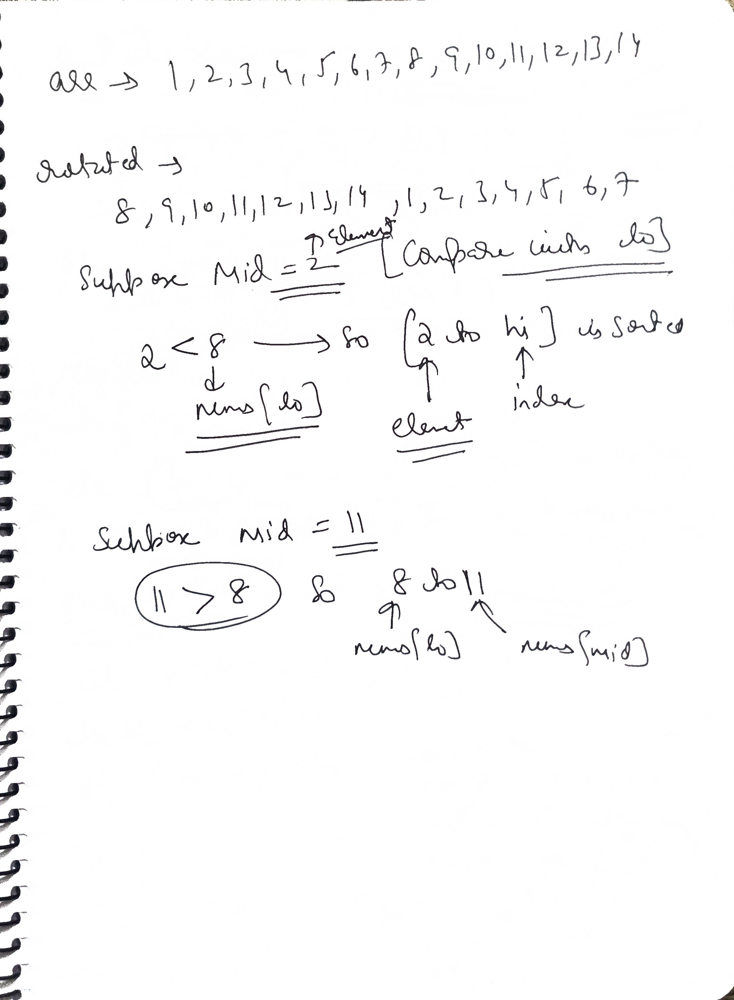
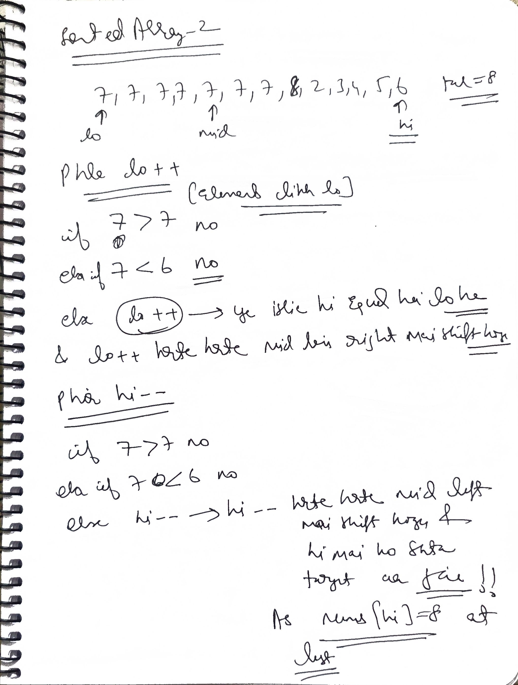
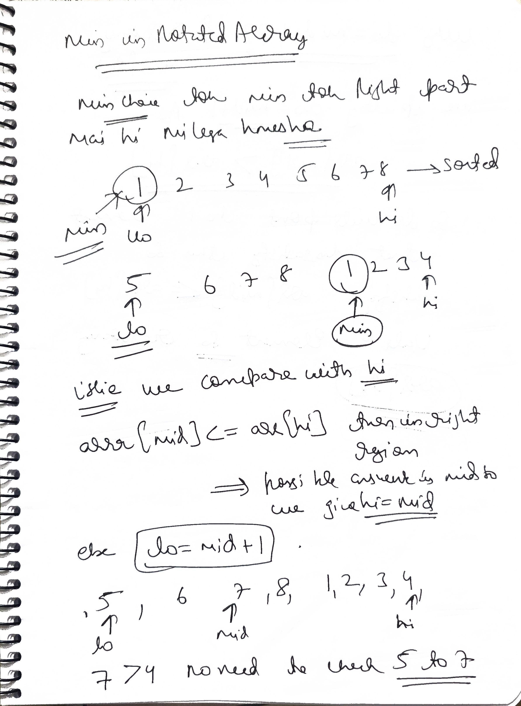
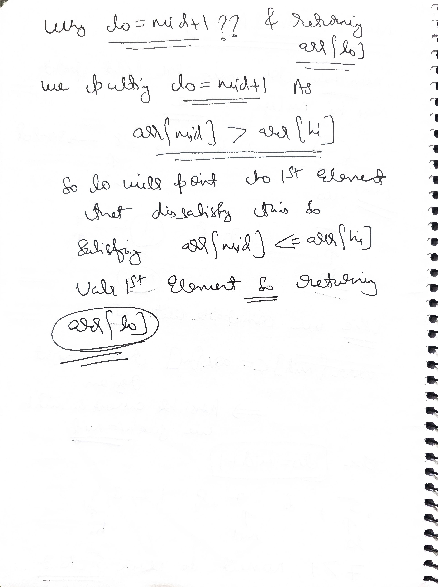

 # Q1 Search in Rotated Sorted Array I

Given an integer array `nums`, sorted in ascending order (with distinct values) and a target value `k`. The array is rotated at some pivot point that is unknown.

Find the index at which `k` is present, and if `k` is not present, return `-1`.

## Examples

**Example 1:**
- **Input:** `nums = [4, 5, 6, 7, 0, 1, 2]`, `k = 0`
- **Output:** `4`
- **Explanation:** The target `0` is present at index 4 in the array.

**Example 2:**
- **Input:** `nums = [4, 5, 6, 7, 0, 1, 2]`, `k = 3`
- **Output:** `-1`
- **Explanation:** The target `3` is not present in the given array.

## Constraints

* `1 <= nums.length <= 10^4`
* `-10^4 <= nums[i] <= 10^4`
* All values of `nums` are unique.
* `nums` is an ascending array that is possibly rotated.
* `-10^4 <= k <= 10^4`

***

 
 


`2<8` case right to 2 is sorted as after 8 as 8 is lo it should be increasing. so here right half is sorted.This is else case of code


 else left half is sorted .If case of code


 now why `if else` inside as there is possibility that element we searching for is not in sorted part . 

```cpp
class Solution {

    int bs(vector<int> &nums, int target,int low ,int high){
        int n=nums.size();
        while(low<=high){
            int mid=(low+high)/2;
            if(nums[mid]==target) return mid;
            // Check if the left part is sorted
            if (nums[low] <= nums[mid]) {
                if (nums[low] <= target && target <= nums[mid]) {
                    // Target exists in the left sorted part
                    high = mid - 1 ;
                } else {
                    // Target does not exist in the left sorted part
                    low = mid + 1;
                }
            } else {
                // Check if the right part is sorted
                if (nums[mid] <= target && target <= nums[high]) {
                    // Target exists in the right sorted part
                    low = mid + 1;
                } else {
                    // Target does not exist in the right sorted part
                    high = mid - 1;
                }
        }
        }
        return -1;
    }
public:
    int search(vector<int> &nums, int k) {
       return bs(nums,k,0,nums.size()-1);
    }
};

```


seee

```cpp
            if (nums[low] <= nums[mid]) {///condition 1
                
            } else {//condition 2 nums[lo]>nums[mid]
               
        }
        }
``` 


 
# Q2 search in rotated sorted array-2


.jpg>) 


```cpp

class Solution {
        int bs(vector<int> &nums, int target,int low ,int high){
        int n=nums.size();
        while(low<=high){
            int mid=(low+high)/2;
            if(nums[mid]==target ||target==nums[low]) return true;
            // Check if the left part is sorted
            if (nums[low] < nums[mid]) {
                if (nums[low] <= target && target <= nums[mid]) {
                    // Target exists in the left sorted part
                    high = mid - 1 ;
                } else {
                    // Target does not exist in the left sorted part
                    low = mid + 1;
                }
            } else if (nums[mid] < nums[high]) {
                // Check if the right part is sorted
                if (nums[mid] <= target && target <= nums[high]) {
                    // Target exists in the right sorted part
                    low = mid + 1;
                } else {
                    // Target does not exist in the right sorted part
                    high = mid - 1;
                }
        } else low++;
        }
        return false;
    }
public:
    bool searchInARotatedSortedArrayII(vector<int> &nums, int k)  {
      return bs(nums,k,0,nums.size()-1);
    }
};
```


# Q3 Find min in rotated sorted array

Given an integer array nums of size N, sorted in ascending order with distinct values, and then rotated an unknown number of times (between 1 and N), find the minimum element in the array.

---
Example 1

Input : nums = [4, 5, 6, 7, 0, 1, 2, 3]

Output: 0

Explanation: Here, the element 0 is the minimum element in the array.

---
Example 2

Input : nums = [3, 4, 5, 1, 2]

Output: 1

Explanation:Here, the element 1 is the minimum element in the array.

---
Example 3

Input : nums = [4, 5, 6, 7, -7, 1, 2, 3]

Output:

-7

---
Constraints

n == nums.length

 1 <= n <= $10^4$

 -$10^4$ <= nums[i] <= $10^4$

 All the integers of nums are unique.
 nums is sorted and rotated between 1 and n times.

 

if we had max in rotated sorted array then we would have searched from `arr[lo]`

```cpp
class Solution {
    private int findPivot(int[] arr){
        int lo=0;
        int hi=arr.length-1;
        while(lo<hi){
            int mid=(lo+hi)/2;
            if(arr[mid]<=arr[hi] ){
                hi=mid;
            }
            else lo=mid+1;
        }
        return arr[lo];
    }
    public int findMin(int[] nums) {
          return findPivot(nums);
    }
}
```


.jpg>)
|


# Q4 find min in rotated sorted array II

**Difficulty:** Hard

## Problem Description

Suppose an array of length `n` sorted in ascending order is **rotated** between `1` and `n` times. For example, the array `nums = [0,1,4,4,5,6,7]` might become:
- `[4,5,6,7,0,1,4]` if it was rotated `4` times.
- `[0,1,4,4,5,6,7]` if it was rotated `7` times.

Notice that **rotating** an array `[a[0], a[1], a[2], ..., a[n-1]]` 1 time results in the array `[a[n-1], a[0], a[1], a[2], ..., a[n-2]]`.

Given the sorted rotated array `nums` that may contain **duplicates**, return *the minimum element of this array*.

You must decrease the overall operation steps as much as possible.

## Examples

**Example 1:**
- **Input:** `nums = [1,3,5]`
- **Output:** `1`

**Example 2:**
- **Input:** `nums = [2,2,2,0,1]`
- **Output:** `0`

## Constraints

- `n == nums.length`
- `1 <= n <= 5000`
- `-5000 <= nums[i] <= 5000`
- `nums` is sorted and rotated between `1` and `n` times.

**Follow up:** This problem is similar to **Find Minimum in Rotated Sorted Array**, but `nums` may contain **duplicates**. Would this affect the runtime complexity? How and why?

## Complexity
- **Time Complexity:**
  - **Average Case:** $O(\log n)$
  - **Worst Case:** $O(n)$ (when elements are identical e.g., `nums[si] == nums[mid] == nums[ei]`, pointers can only be shrunk by 1 step at a time)
- **Space Complexity:** $O(1)$

 
 
.jpg>) 
 
 .jpg>)

 
 
 
 ```cpp
 class Solution {
public:
    int findMin(vector<int>& arr) {
            int si=0;
      int ei=arr.size()-1;
       int ans = INT_MAX;  
      while(si<=ei){
        int mid=(si+ei)/2;
        if (arr[si] == arr[mid] && arr[mid] == arr[ei]) {
                ans = min(ans, arr[si]);
                si++;
                ei--;
                continue; // Skip the rest of the loop logic
            }
        if(arr[mid]>=arr[si]){//si to mid is sorted and min is si
            ans = min(ans, arr[si]);  
            si=mid+1;
        }else{//arr[mid]<arr[si] so arr[si] is not min and si to mid we have a j which is min or mid is that j so need to go on left
            ans = min(ans, arr[mid]);  
            ei=mid-1;
        }
      }
      return ans;
    }
};
```
 ### Why we need `continue`

When we execute `si++` and `ei--`, the boundaries of our search space change. We immediately want to **restart the loop** to recalculate `mid` using these new boundaries. 

We use `continue` to prevent the code from executing the rest of the binary search logic (the `mid` comparisons) with stale or invalid logic states. It ensures that the very next thing the program does is re-check the `while` condition and compute a fresh, accurate `mid`.

---

### Complexity Analysis

* **Average Case: $O(\log N)$**
    * In most scenarios, the array will still allow us to discard half of the search space in each step, behaving like a standard binary search.

* **Worst Case: $O(N)$**
    * **Example:** `[1, 1, 1, 1, 1, 1, 1]` or `[1, 1, 1, 0, 1, 1, 1]`.
    * If the `si`, `mid`, and `ei` elements are all identical, we cannot mathematically determine which half is sorted. We are forced to shrink the range step-by-step (`si++` and `ei--`). 
    * This linear time complexity is **unavoidable** for rotated arrays containing duplicates.

---

### Summary Table

| Case | Complexity | Condition |
| :--- | :--- | :--- |
| **Best Case** | $O(1)$ | Target found at the first `mid`. |
| **Average Case** | $O(\log N)$ | Distinct elements or clear rotation point. |
| **Worst Case** | $O(N)$ | Many duplicates making `nums[si] == nums[mid] == nums[ei]`. |


solution by rajneesh is also worst case O(n) solution !! Both are same!!

# Q5 find peak element
 
  .jpg>) .jpg>) 


```java
class Solution {
    public int peakIndexInMountainArray(int[] arr) {
         int n=arr.length;
        int lo=0;
        int hi=n-1;
        while(lo<hi){
            int mid=(lo+hi)/2;

            if(mid>0&&mid<n){
                if(arr[mid]>arr[mid-1]&& arr[mid]>arr[mid+1]) return mid;
                else if(arr[mid]<arr[mid-1] && arr[mid]>arr[mid+1]) hi=mid-1; 
                else lo=mid+1;
            }
            else   if(mid==0){
                return arr[0]>arr[1]?0:1;
            }
            else if(mid==n-2){//this is not required as covered by mid>0 &&mid<n 1st if iske bina bhi submit hora
                return arr[n-1]>arr[n-2]?n-1:n-2;
            }
   
        }
        return lo;
      }
}
```
Here we  are handing `mid=0` and `mid=n-2` case if another case as those are edge cases and we might need to check if `mid-1>0` and  `mid+1<n` so we wanted to avoid that


`if(arr[mid]<arr[mid-1] && arr[mid]>arr[mid+1]) hi=mid-1; ` decreasing part of mountain 

better write as `if(arr[mid-1]>arr[mid] && arr[mid]>arr[mid+1]) hi=mid-1; `


 `elements at mid-1>mid>mid+1` so we put hi=mid-1 as we need to find peak


 else we are in increasing part so lo=mid+1

Complexity Analysis: 
Time Complexity:O(logN), N is size of the given array. As binary search is being used to find the minimum.

Space Complexity: As no additional space is used, so the Space Complexity is O(1).


# Q6 Find how many time array is rotated

Given an integer array nums of size n, sorted in ascending order with distinct values. The array has been right rotated an unknown number of times, between 0 and n-1 (including). Determine the number of rotations performed on the array.

---

Example 1

Input : nums = [4, 5, 6, 7, 0, 1, 2, 3]

Output: 4

Explanation: The original array should be [0, 1, 2, 3, 4, 5, 6, 7]. So, we can notice that the array has been rotated 4 times.

---

Example 2

Input: nums = [3, 4, 5, 1, 2]

Output: 3

Explanation: The original array should be [1, 2, 3, 4, 5]. So, we can notice that the array has been rotated 3 times.

---

Example 3

Input: nums = [4, 5, 1, 2]

Output:

2

----

Constraints

 - n == nums.length
 - 1 <= n <= $10^4$
 - -$10^4$ <= nums[i] <= $10^4$
 - All the integers of nums are unique.


```cpp
class Solution {
public:
    int findKRotation(vector<int> &arr)  {
        int si=0;
      int ei=arr.size()-1;
       int ans = INT_MAX;  
       int index=-1;
      while(si<=ei){
        int mid=(si+ei)/2;
        if(arr[mid]>=arr[si]){
            if(arr[si]<ans){
                ans=arr[si];
                index=si;
            }
            si=mid+1;
        }else{
            if(arr[mid]<ans){
                ans=arr[mid];
                index=mid;
            }
            ei=mid-1;
        }
      }
      return index;
    }
};
```
