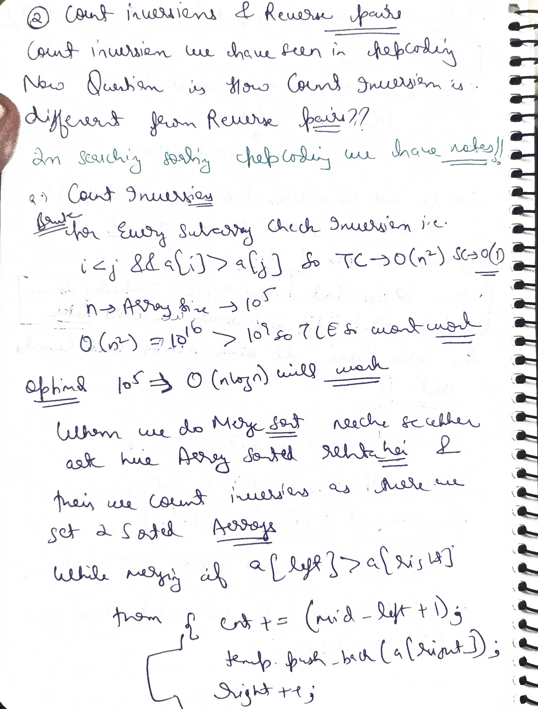
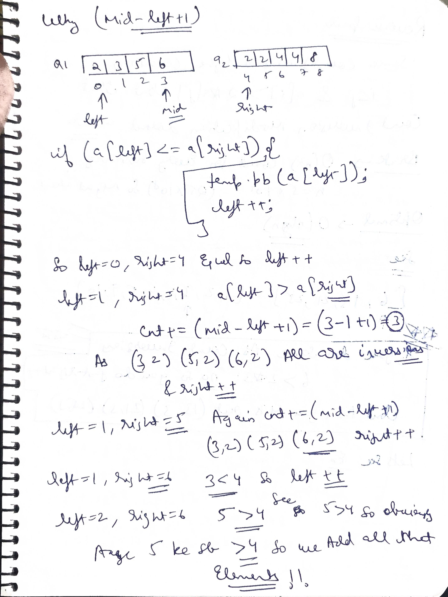
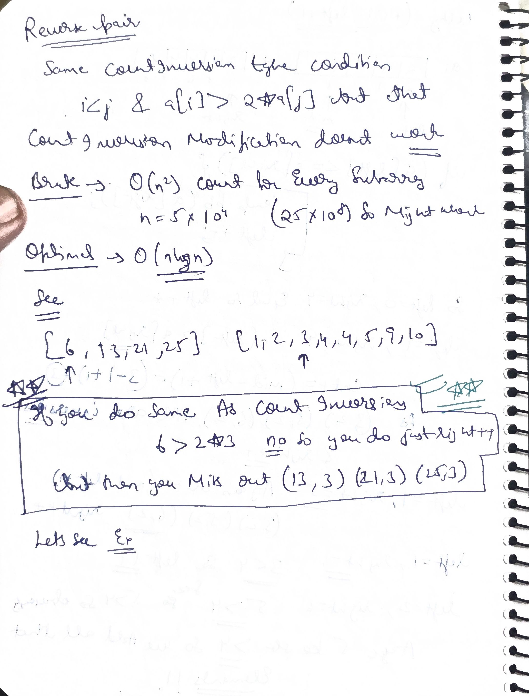
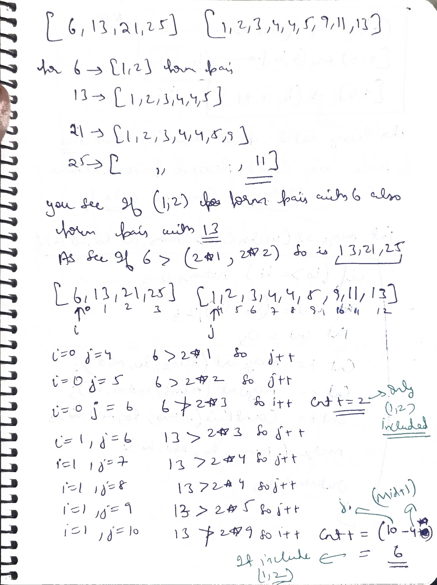
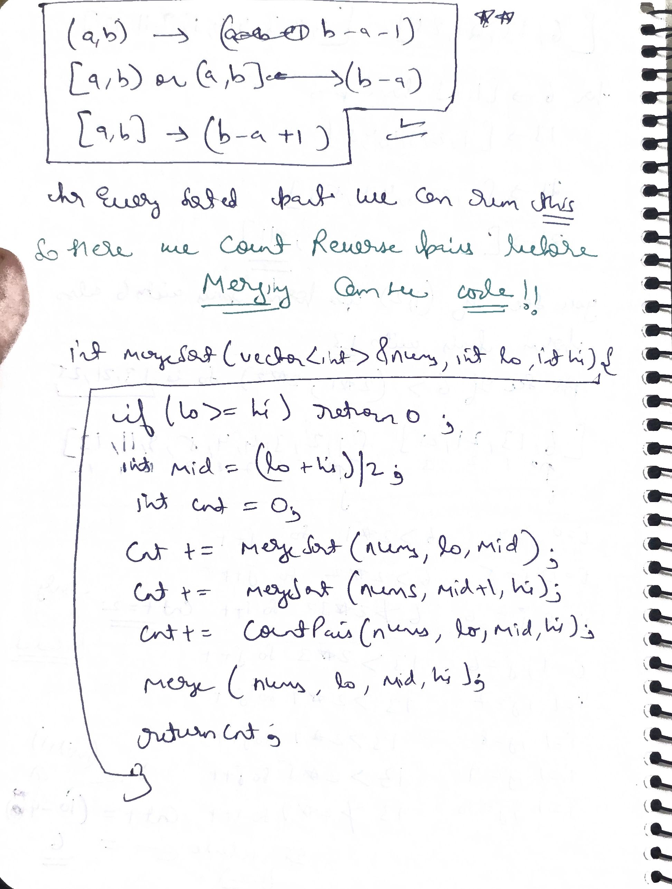
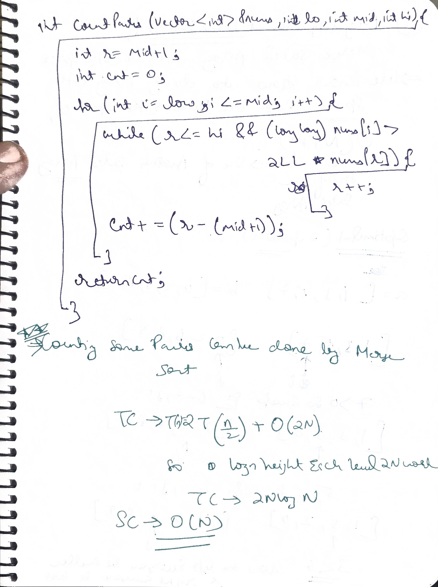

# Q1  Reverse Pairs (LeetCode 493)

Given an integer array `nums`, return *the number of **reverse pairs** in the array*.

A **reverse pair** is a pair `(i, j)` where:
- `0 <= i < j < nums.length` and
- `nums[i] > 2 * nums[j]`

---

### Examples

**Example 1:**
```text
Input: nums = [1,3,2,3,1]
Output: 2
Explanation: The reverse pairs are:
- (1, 4) --> nums[1] = 3, nums[4] = 1, 3 > 2 * 1
- (3, 4) --> nums[3] = 3, nums[4] = 1, 3 > 2 * 1
```

**Example 2:**
```text
Input: nums = [2,4,3,5,1]
Output: 3
Explanation: The reverse pairs are:
- (1, 4) --> nums[1] = 4, nums[4] = 1, 4 > 2 * 1
- (2, 4) --> nums[2] = 3, nums[4] = 1, 3 > 2 * 1
- (3, 4) --> nums[3] = 5, nums[4] = 1, 5 > 2 * 1
```

---

### Constraints

- `1 <= nums.length <= 5 * 10^4`
- `-2^31 <= nums[i] <= 2^31 - 1`

> **Note on Overflow:** Since `nums[i]` can be as large as $2^{31} - 1$ or as small as $-2^{31}$, evaluating `2 * nums[j]` can overflow a standard 32-bit signed integer. Always cast `nums[j]` to a 64-bit integer (`long long` in C++ / `long` in Java) before multiplying by 2 (i.e., `nums[i] > 2LL * nums[j]`).


     
```cpp
class Solution {
public:
    int reversePairs(vector<int>& nums) {
        return mergeSort(nums, 0, nums.size() - 1);
    }

private:
    // Function to count reverse pairs across two sorted halves
    int countPairs(vector<int>& nums, int low, int mid, int high) {
        int right = mid + 1;
        int cnt = 0;
        for (int i = low; i <= mid; i++) {
            while (right <= high && (long long)nums[i] > 2LL * nums[right]) {
                right++;
            }
            cnt += (right - (mid + 1));
        }
        return cnt;
    }

    // Standard merge function to merge two sorted halves
    void merge(vector<int>& nums, int low, int mid, int high) {
        vector<int> temp;
        int left = low;
        int right = mid + 1;

        while (left <= mid && right <= high) {
            if (nums[left] <= nums[right]) {
                temp.push_back(nums[left++]);
            } else {
                temp.push_back(nums[right++]);
            }
        }

        while (left <= mid) temp.push_back(nums[left++]);
        while (right <= high) temp.push_back(nums[right++]);

        for (int i = low; i <= high; ++i) {
            nums[i] = temp[i - low];
        }
    }

    // Merge Sort + Counting Reverse Pairs
    int mergeSort(vector<int>& nums, int low, int high) {
        if (low >= high) return 0;

        int mid = low + (high - low) / 2;
        int cnt = 0;

        cnt += mergeSort(nums, low, mid);
        cnt += mergeSort(nums, mid + 1, high);
        cnt += countPairs(nums, low, mid, high);
        merge(nums, low, mid, high);

        return cnt;
    }
};

```


# Q2. Maximize Area of Square Hole in Grid (LeetCode 2943)

There is an `m x n` grid that is initially formed by `n + 2` horizontal bars and `m + 2` vertical bars. The bars are 1-indexed.

You are given two integers `n` and `m`, and two integer arrays `hBars` and `vBars`.
- `hBars` contains the indices of horizontal bars that can be removed.
- `vBars` contains the indices of vertical bars that can be removed.

When you remove a horizontal or vertical bar, the boundary between adjacent cells disappears, merging them into a larger opening.

Return *the **maximum possible area** of a **square-shaped hole** that can be formed after removing some bars (possibly none).*

---

### Examples

**Example 1:**
```text
Input: n = 2, m = 1, hBars = [2, 3], vBars = [2]
Output: 4
Explanation:
The initial grid has horizontal bars [1, 2, 3, 4] and vertical bars [1, 2, 3].
By removing horizontal bar 2 and vertical bar 2, we can form a square hole of size 2 x 2.
The maximum square area is 2 * 2 = 4.
```

**Example 2:**
```text
Input: n = 1, m = 1, hBars = [2], vBars = [2]
Output: 4
Explanation:
The initial grid has horizontal bars [1, 2, 3] and vertical bars [1, 2, 3].
By removing horizontal bar 2 and vertical bar 2, the adjacent 1x1 cells merge to form a 2 x 2 square hole.
The maximum square area is 2 * 2 = 4.
```

**Example 3:**
```text
Input: n = 2, m = 3, hBars = [2, 3], vBars = [2, 4]
Output: 4
Explanation:
- Longest consecutive horizontal bars we can remove: [2, 3] (length 2), creating a span of 2 + 1 = 3.
- Longest consecutive vertical bars we can remove: [2] or [4] (length 1), creating a span of 1 + 1 = 2.
- Since the hole must be a square, side = min(3, 2) = 2.
- Maximum square area = 2 * 2 = 4.
```

---

### Constraints

- `1 <= n <= 10^9`
- `1 <= m <= 10^9`
- `1 <= hBars.length <= 100`
- `2 <= hBars[i] <= n + 1`
- `1 <= vBars.length <= 100`
- `2 <= vBars[i] <= m + 1`
- All values in `hBars` are **distinct**.
- All values in `vBars` are **distinct**.


    


```java
//Approach (Sort and process)
//T.C : O(vlogv + hlogh), v = vBars.size(), h = hBars.size()
//S.C : O(1)
class Solution {
    public int maximizeSquareHoleArea(int n, int m, int[] hBars, int[] vBars) {
        //1st Step : Sort the inputs
        Arrays.sort(hBars);
        Arrays.sort(vBars);

        int maxConsecutiveHBars = 1; //Length of Longest consecutive horizontal bars
        int maxConsecutiveVBars = 1; //Length of Longest consecutive Vertical bars

        //First find Length of Longest consecutive horizontal bars
        int currConsecutiveHBars = 1;
        for (int i = 1; i < hBars.length; i++) {
            if (hBars[i] - hBars[i - 1] == 1) {
                currConsecutiveHBars++;
            } else {
                currConsecutiveHBars = 1;
            }
            maxConsecutiveHBars = Math.max(maxConsecutiveHBars, currConsecutiveHBars);
        }

        //Simialrl, find Length of Longest consecutive vertical bars
        int currConsecutiveVBars = 1;
        for (int i = 1; i < vBars.length; i++) {
            if (vBars[i] - vBars[i - 1] == 1) {
                currConsecutiveVBars++;
            } else {
                currConsecutiveVBars = 1;
            }
            maxConsecutiveVBars = Math.max(maxConsecutiveVBars, currConsecutiveVBars);
        }

        //Square width and height must be same. We can reduce the larger one to match the smaller one
        // So, take the minimum of them.
        int side = Math.min(maxConsecutiveHBars, maxConsecutiveVBars) + 1;
        
        return side * side;
    }
}
```